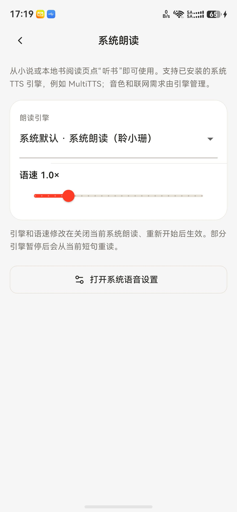

<p align="center">
  
</p>

<h1 align="center">博观</h1>

<p align="center">
  <strong>让阅读和追剧，简单一点。</strong><br>
  小说 · 听书 · 短剧 · 漫剧 · 漫画
</p>

<p align="center">
  
  <a href="LICENSE"></a>
  
</p>

<p align="center">
  <a href="#功能">功能</a> ·
  <a href="#截图">截图</a> ·
  <a href="#构建与安装">构建与安装</a> ·
  <a href="#架构">架构</a> ·
  <a href="#已知限制">已知限制</a> ·
  <a href="#常见问题">常见问题</a> ·
  <a href="OHOS.md">鸿蒙构建文档</a>
</p>

---

## 关于博观

博观是一个 **HarmonyOS（鸿蒙）原生** 的阅读与影音客户端：读小说、听有声书、刷短剧与漫剧，进度与书架都在设备本地。

- 界面由 Flutter 构建；网络、签名、解密、本地缓存与内置 HTTP 服务由随包分发的 Rust 核心完成；
- 视频播放、后台播放、媒体通知与系统朗读，通过 ArkTS 插件调用鸿蒙系统能力（AVPlayer / AVSession / Core Speech Kit）；
- 只发布鸿蒙版本，不提供安卓或桌面安装包。

本项目沿用开源项目 [ch6vip/novel-sound](https://github.com/ch6vip/novel-sound) 的界面与业务逻辑（GPL-3.0），**鸿蒙端移植与实现由本项目维护**，并在移植过程中重写了播放器与朗读链路。

仓库只保留鸿蒙工程：`ohos/`（ArkTS 插件与 HAP 工程）、`lib/`（Flutter 界面与业务）、`rust/`（网络 / 签名 / 解密核心）、`native/`（加密与时伸缩 C 源码）、`scripts/`、`test/`。上游的 `android/`、`ios/`、`linux/`、`windows/` 工程及其构建脚本、CI 已全部移除。

## 功能

| 功能 | 状态 |
| --- | --- |
| 首页 / 榜单 / 分类 / 书架 | ✅ 可用 |
| 阅读器（正文、章节缓存、阅读进度） | ✅ 可用 |
| 短剧 / 漫剧播放（含加密源解密） | ✅ 可用，AVPlayer + Flutter 外部纹理 |
| 听书（作品朗读音频） | ✅ 可用，后台播放不中断 |
| 系统朗读（离线 TTS，逐句高亮） | ✅ 可用，Core Speech Kit |
| 后台播放 / 媒体通知 | ✅ 可用，长时任务 + AVSession |
| 本机密钥库（设备池密钥、Hive 密钥） | ✅ 可用，Asset Store Kit |
| 画中画（PiP） | ⏳ 开发中，需要 XComponent 双输出 |
| 悬浮窗小窗 | ⛔ 鸿蒙不开放全局悬浮窗，插件已软降级 |
| 本地加密缓存回放 | ⏳ 尚未在真机验证 |

## 截图

<p align="center">
  
  
  
</p>
<p align="center"><sub>鸿蒙真机：短剧播放 · 系统朗读逐句高亮 · 朗读引擎与语速</sub></p>

## 构建与安装

前置环境（版本与踩坑详见 [OHOS.md](OHOS.md)）：

- Flutter 3.50.0 + OHOS 适配版、HarmonyOS SDK、DevEco Studio（hvigor 6.x）
- Rust 1.100+，目标 `aarch64-unknown-linux-ohos`
- 安装 `path_provider_ohos` 等鸿蒙适配插件后，需运行一次 `dart run tool/patch_ohos_packages.dart`

```powershell
flutter pub get
dart run tool/patch_ohos_packages.dart
powershell -File .\scripts\build_rust_backend_ohos.ps1 -SkipCodegen
flutter build hap --debug

$hdc = 'D:\ohsdk\default\openharmony\toolchains\hdc.exe'
& $hdc install .\build\ohos\hap\entry-default-signed.hap
& $hdc shell aa start -a EntryAbility -b com.shijinpu.fqapp
```

注意事项：

- 首次构建时 hvigor 会走 **Auto-signing**，生成调试证书并回写 `ohos/build-profile.json5` —— 该文件是本机签名材料，**不要提交**；
- 只打包 `ohos/entry/libs/arm64-v8a/` 里的 `.so`；改了 Rust 代码必须重跑上面的 Rust 构建脚本，否则设备上仍是旧库；
- **换了签名证书要先清数据再装**：`hdc shell bm uninstall -n com.shijinpu.fqapp`，否则启动页会报 `encrypted pool file authentication failed`；
- 日志域 `0xF0A0`：`hdc shell "hilog -x | grep -E 'A0F0A0'"`。

## 架构

```
Flutter (Dart)
 ├─ Rust 核心 libfqapi_core.so      网络 / 签名 / 解密 / CENC 索引 / 127.0.0.1 环回服务
 ├─ ArkTS 插件（FlutterPlugin）      fqapp/secure_keys、fqapp/native_player、fqapp/system_tts
 └─ NAPI 模块 libfq_native.so        Flutter 纹理 → AVPlayer surfaceId、Rust 媒体源桥接
```

- **解密播放**：Rust 用内置密钥解开 CENC 视频，通过 `127.0.0.1` 环回 HTTP 以 Range 分块提供；`AVPlayer` 只播明文本地源，播放器里没有任何解密逻辑。
- **视频输出**：`TextureRegistry.registerTexture()` → `SurfaceTextureEntry.getSurfaceId()` → `AVPlayer.surfaceId`，画面直接进 Flutter 外部纹理。
- **后台与通知**：`UIAbilityContext` + `startBackgroundRunning(AUDIO_PLAYBACK)` + `createAVSession`，通知栏可控制播放。
- **系统朗读**：`@kit.CoreSpeechKit` 的离线 `textToSpeech`（聆小珊等音色），插件逐句 speak 并回传 `start` / `done` / `error` 事件，由界面驱动高亮推进。
- **密钥**：Asset Store Kit（等价 iOS Keychain），应用不接触密钥材料。

## 已知限制

- **画中画** 未实现：需要 `XComponent` 双输出（Flutter 纹理 + PiP surface），PoC 已验证可行。
- **悬浮窗** 不提供：鸿蒙手机不开放全局悬浮窗权限，插件返回「不支持」，入口不出现。
- **本地加密缓存回放** 未在真机验证；未下载的在线内容不受影响。
- **系统朗读** 的语速、音量由离线引擎管理，应用侧只记录；鸿蒙没有朗读引擎设置页可跳转。
- Dart 层仍有少量桌面平台分支（`lib/services/desktop_platform.dart` 等），鸿蒙构建不会注册这些插件，功能上无影响；仓库不再包含它们的宿主工程。

## 常见问题

<details>
<summary><b>安装后启动报「启动失败 / encrypted pool file authentication failed」？</b></summary>

本机密钥与签名身份绑定。换了签名证书（例如从正式包切到调试自动签名）后，旧数据无法解密。清数据重装即可：

```powershell
hdc shell bm uninstall -n com.shijinpu.fqapp
hdc install .\build\ohos\hap\entry-default-signed.hap
```

卸载会清除本地书、缓存与进度，重要数据请先备份（应用内「我的 → 备份与导入」）。

</details>

<details>
<summary><b>视频能播放，但没有画面（黑屏）？</b></summary>

确认是本地构建的 HAP 且 `ohos/entry/libs/arm64-v8a/libfqapi_core.so` 是最新的（改了 Rust 代码没重编会出现旧库）。实在异常时抓一份 `hilog -x | grep -E 'A0F0A0|fqapp_player'` 的日志反馈，能看到创建播放器、设置 surfaceId、首帧的完整链路。

</details>

<details>
<summary><b>系统朗读没有声音？</b></summary>

先确认媒体音量；鸿蒙端使用系统内置的 Core Speech Kit 离线引擎，鸿蒙没有第三方朗读引擎设置页，语速在应用内「设置 → 听书 → 系统朗读」，音色固定为系统提供的「聆小珊」等。若提示引擎初始化失败，多半是设备引擎实例被占用，重开应用即可。

</details>

<details>
<summary><b>切到后台后播放/朗读会停吗？</b></summary>

不会。视频与听书走长时任务（`KEEP_BACKGROUND_RUNNING` + `audioPlayback`），系统朗读引擎以 `isBackStage` 方式创建，切后台、锁屏仍会继续；通知栏会显示媒体控制卡片。

</details>

<details>
<summary><b>为什么只有鸿蒙版本？</b></summary>

本项目只面向 HarmonyOS 做移植与维护，不提供安卓或桌面安装包。其他平台的实现与发行请参考上游开源项目。

</details>

<details>
<summary><b>一直加载、搜索失败或播放不了？</b></summary>

先检查网络；在线内容依赖第三方服务，对方调整或网络波动可能导致暂时不可用。若开着代理或广告过滤，首次使用在线内容需要放行精确域名 `log.snssdk.com:443`（上游设备注册），不要放行整个域名族。

持续失败请到 [Issues](https://github.com/hero708/boguan/issues) 反馈，附应用版本、设备型号（如 HarmonyOS 26 / API 26）、作品名称与错误截图；崩溃或黑屏再附 hilog 摘要。

</details>

## 参与与反馈

- 问题与建议：本仓库 [Issues](https://github.com/hero708/boguan/issues)；
- 鸿蒙构建、签名、播放相关的改动请先看 [OHOS.md](OHOS.md)，其中有完整的环境搭建、真机安装与日志方法；
- 提交反馈时请勿附上代理订阅、凭据、完整签名 URL 或设备标识。

## 许可与致谢

- 项目采用 [GPL-3.0](LICENSE) 开源协议；界面与业务逻辑源自 [ch6vip/novel-sound](https://github.com/ch6vip/novel-sound)（作者 ch6vip 及贡献者），鸿蒙端移植与实现由本项目维护，同样以 GPL-3.0 发布。
- 界面参考 [Wenku8 界面项目](assets/licenses/wenku8/PORTING.md)，感谢 [LINUX DO](https://linux.do/) 社区。

在线内容来自第三方，版权归各自权利人。本项目与内容提供方无隶属关系，不托管作品，不绕过付费或访问权限。

书架、进度和缓存保存在设备上。如开启 AI 校对或云端同步，相关内容会发送到你选择的服务，使用前请阅读应用内说明。
